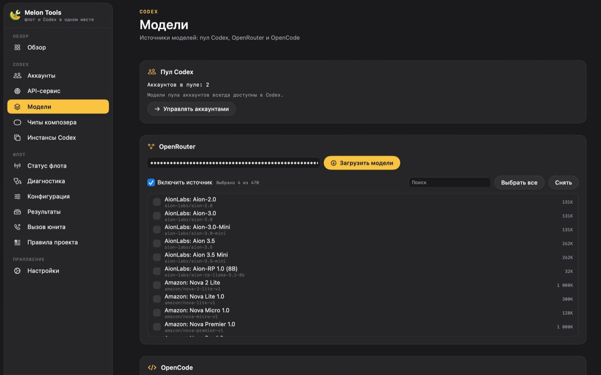

<div align="center">
  
  <h1>Melon Tools</h1>
  <p><strong>Your Codex accounts, model providers and scheduled tasks — in one local desktop app for macOS and Windows.</strong></p>
  <p>
    <a href="https://github.com/vanich-git/MelonTools/releases/latest/download/MelonTools.dmg"><strong>Download for macOS</strong></a>
    ·
    <a href="https://github.com/vanich-git/MelonTools/releases/latest/download/MelonTools-setup.exe"><strong>Download for Windows</strong></a>
    ·
    <a href="MacOS/RELEASE_NOTES.md">Release notes</a>
    ·
    <a href="docs/FAQ.md">FAQ</a>
  </p>
  <p>
    <a href="https://github.com/vanich-git/MelonTools/releases/latest"></a>
    <a href="https://github.com/vanich-git/MelonTools/actions/workflows/ci.yml"></a>
    
    
    <a href="LICENSE"></a>
  </p>
  <p><a href="README.ru.md">Русская версия</a></p>
</div>


## What Melon Tools does

Melon Tools is a desktop companion for people who work with Codex every day. It keeps your Codex accounts in a local vault, shows live quota, and runs a small OpenAI-compatible gateway on `127.0.0.1:18317` so Codex and other tools can use the accounts you configured.

It also connects third-party model providers, labels every model in the Codex picker, keeps Codex working through transient capacity errors, and runs prompt-based tasks on a schedule while the app sits in the menu bar or tray.

Everything runs on your machine. Credentials stay local, the gateway listens on loopback only, and Melon Tools sends account data nowhere except the provider you signed in to.

## Features

| Capability | What you get |
|---|---|
| **Codex account pool** | Add Codex accounts to a local vault, refresh usage, enable or disable accounts, and route requests across the pool. |
| **Quota at a glance** | Per-account and pooled quota with reset times, the 5-hour window, and a quota-aware guard that pauses automation before limits run out. |
| **Local OpenAI-compatible gateway** | A loopback gateway on `127.0.0.1:18317` with an API key you control, usage metrics and an audit log. |
| **Model providers** | Claude and Google Antigravity use OAuth; OpenRouter, OpenCode, DeepInfra, Vercel AI Gateway and Z.ai GLM Coding Plan connect with an API key. |
| **Antigravity pool** | Connect several Google accounts, see each account's models and 5-hour quota, pause or refresh one account, and let the engine fail over when the first token is slow. |
| **Codex composer chips** | Account and usage chips inside the Codex composer, so the active account and remaining quota stay visible while you prompt. |
| **Survives capacity errors** | Presses Codex's Retry automatically, then sends a short continuation if Retry is gone — and stays quiet when the pool is paused or nearly exhausted. |
| **Scheduled tasks** | Run a prompt on an interval or a five-field cron schedule with a time zone. Five templates cover digests, PR review, repository summaries, log checks and spend reports. |
| **Two native apps** | A SwiftUI app for macOS and a Tauri app for Windows share the same feature set and the same local data model. |

## Screenshots

| Model providers | Inside Codex |
|---|---|
|  |  |

## Download and install

### macOS

1. Download **[MelonTools.dmg](https://github.com/vanich-git/MelonTools/releases/latest/download/MelonTools.dmg)**.
2. Open the image and drag **Melon Tools.app** to **Applications**.
3. On first launch use **right-click → Open** if Gatekeeper blocks the app.

The universal build runs on Apple Silicon and Intel Macs with macOS 14 (Sonoma) or later. The app is ad-hoc signed and not notarized yet, so Gatekeeper shows its usual warning until an Apple Developer certificate is configured.

### Windows

1. Download the **[installer](https://github.com/vanich-git/MelonTools/releases/latest/download/MelonTools-setup.exe)** and choose any writable folder, or use the **[portable build](https://github.com/vanich-git/MelonTools/releases/latest/download/MelonTools-win-x64-portable.exe)** without installing.
2. Requires Windows 10 (1809) or later, x64, and the WebView2 Runtime (already present on current Windows).
3. The app is not Authenticode-signed yet, so SmartScreen may show *Windows protected your PC*. Choose **More info → Run anyway** after verifying the checksum.

Your data lives in `%APPDATA%\MelonTools` and survives an uninstall.

### Verify a download

Every file has a `.sha256` companion, and each release ships a single `SHA256SUMS`:

```bash
shasum -a 256 -c MelonTools.dmg.sha256          # macOS
certutil -hashfile MelonTools-setup.exe SHA256  # Windows
```

## What's new in 5.0.0

- **Flat dark canvas.** One `#111113` surface behind the sidebar and the board; cards are `#1F1F22` plates with an 18 pt radius and a neutral hairline. Coloured frames, glows, shadows and per-card blurs are gone, so long boards no longer stutter while scrolling.
- **Floating sidebar.** A selected row takes a soft tint of its section accent, a matching glyph and a trailing dot; hover stays a neutral wash.
- **Bento dashboard.** Two equal columns whose cards stretch to the row height. New **Providers** and **Account pools** cards list every connected upstream and every pool (Codex, Antigravity, Claude) with model and account counts.
- **Pool totals, not averages.** "Codex pool health" and the status bar panel sum the remaining quota: five accounts at 100% read 500% of 500% for the 5-hour window.
- **Cleaner status bar panel.** The account list is gone, the monospaced face is replaced by the system font, rows gain hover states and the duplicated status string is fixed.
- **Windows parity.** The Tauri app ships the same palette, radii, cards, hero, provider/pool cards and summary maths; only the system font differs.
- **New identity.** The amber melon-slice icon and the transparent logo ship in both apps.

Read the [full changelog](MacOS/RELEASE_NOTES.md) for every release.

## Earlier: 4.0.1

- **Probe clears every cooldown.** One first-token timeout can quarantine several models of the same account; a successful probe now releases all of them on macOS and Windows instead of only the first.
- **Idle pool calls Google less.** The macOS quota poll follows gateway load like Windows: 60 s under traffic, 15 min when idle, so battery use and quota-endpoint rate limits drop.
- **Logs rotate during long sessions.** `gateway.log` is rotated by the watchdog once it passes 32 MB while the pool is idle, so a machine left running for weeks no longer grows the file without bound.
- **The quarantine badge names its reason.** The account row now distinguishes a first-token timeout, exhausted quota, Cloudflare challenge, sign-in failure and plan/payment problems.

Read the [full changelog](MacOS/RELEASE_NOTES.md) for every release.

## Earlier: 4.0.0

- **Antigravity is a real account pool.** Connect any number of Google accounts; each row shows identity, project, model count, pause/resume, sign-in refresh and removal. The engine routes across the pool instead of the newest auth file.
- **A quota you can see.** `fetchAvailableModels` exposes `quotaInfo`; the app groups it into the Gemini and Claude/GPT pools, shows the remaining share of the 5-hour window and its reset time, and does not invent the weekly window the API does not expose.
- **Catalog-only models are explained.** A grey block lists model ids the catalog defines but no connected account can use, with the reason.
- **First-token failover.** If an Antigravity stream produces no first payload within `stream-bootstrap-timeout-seconds` (default 60), the engine retries on another account and quarantines the slow one for 60 s → 5 min → 30 min → 2 h. Codex, Claude and API-key providers are unaffected.
- **Update checks follow this repository.** The in-app updater asks `api.github.com/repos/vanich-git/MelonTools` on both platforms.

Read the [full changelog](MacOS/RELEASE_NOTES.md) for every release.

## Requirements

- **macOS:** 14.0 or later, Apple Silicon or Intel.
- **Windows:** 10 (1809) or later, x64, WebView2 Runtime.
- **Optional:** the Codex CLI or the Codex desktop app, if you want the gateway and composer integration.

## Build from source

macOS:

```bash
./MacOS/scripts/fetch-sources.sh
./MacOS/build.sh
```

Requires Xcode 27+, XcodeGen and Go 1.26.10. The script produces a universal app and a DMG under `MacOS/build/`.

Windows (cross-compiled on macOS, or natively on Windows):

```bash
./Windows/build-windows.sh
```

The [Windows guide](Windows/README.md) documents the Rust/Tauri toolchain, the gateway sidecar and the NSIS installer.

Run the tests with:

```bash
xcodebuild -project MacOS/app/MelonTools.xcodeproj -scheme MelonTools \
  -configuration Debug -destination 'platform=macOS' \
  -derivedDataPath "$HOME/Library/Developer/MelonTools" CODE_SIGNING_ALLOWED=NO test

cd Windows/app/src-tauri && cargo test
```

On an exFAT volume, run `./scripts/doctor.sh` first: it reports AppleDouble sidecars and unexpected file modes without changing anything.

## Documentation

- [FAQ](docs/FAQ.md) — providers, quota, updates and troubleshooting.
- [Security model](docs/SECURITY-MODEL.md) — local data, the loopback gateway, CDP trust and updater verification.
- [macOS guide](MacOS/README.md) and [Windows guide](Windows/README.md) — setup, data locations and build details.
- [Packaging and signing](packaging/README.md) — release secrets, checksums, Homebrew Cask and winget manifests.

## Security and privacy

Account credentials and provider keys are stored on your device. The local gateway binds to loopback; requests go to OpenAI or to the providers you configure. The repository contains no credentials and no telemetry.

Report a vulnerability through [GitHub private vulnerability reporting](https://github.com/vanich-git/MelonTools/security/advisories/new) instead of a public issue.

## Contributing

Bug reports and focused pull requests are welcome — see [CONTRIBUTING.md](CONTRIBUTING.md). For a larger change, open an issue first so the scope can be discussed.

## License

Melon Tools is released under the [MIT License](LICENSE). Third-party component provenance is documented in [MacOS/README.md](MacOS/README.md).

Melon Tools is an independent project and is not affiliated with or endorsed by OpenAI.
