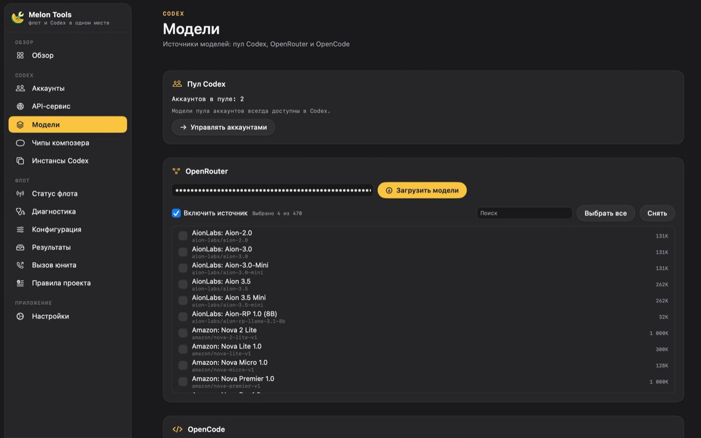

<div align="center">
  
  <h1>Melon Tools</h1>
  <p><strong>Аккаунты Codex, модели-провайдеры и задачи по расписанию — в одном локальном приложении для macOS и Windows.</strong></p>
  <p>
    <a href="https://github.com/vanich-git/MelonTools/releases/latest/download/MelonTools.dmg"><strong>Скачать для macOS</strong></a>
    ·
    <a href="https://github.com/vanich-git/MelonTools/releases/latest/download/MelonTools-setup.exe"><strong>Скачать для Windows</strong></a>
    ·
    <a href="MacOS/RELEASE_NOTES.md">Список изменений</a>
    ·
    <a href="docs/FAQ.md">FAQ</a>
  </p>
  <p>
    <a href="https://github.com/vanich-git/MelonTools/releases/latest"></a>
    
    
    <a href="LICENSE"></a>
  </p>
  <p><a href="README.md">English version</a></p>
</div>


## Что делает Melon Tools

Melon Tools — настольный помощник для тех, кто каждый день работает с Codex. Приложение хранит аккаунты Codex в локальном хранилище, показывает актуальные квоты и поднимает небольшой OpenAI-совместимый шлюз на `127.0.0.1:18317`, чтобы Codex и другие инструменты могли пользоваться настроенными аккаунтами.

Кроме этого Melon Tools подключает сторонних провайдеров моделей, подписывает модели в списке Codex, помогает пережить временные ошибки мощности и запускает задачи по расписанию, пока приложение висит в строке меню или в трее.

Всё работает на вашей машине. Учётные данные остаются локально, шлюз слушает только loopback, а данные аккаунтов никуда не отправляются, кроме провайдера, в котором вы вошли.

## Возможности

| Возможность | Что даёт |
|---|---|
| **Пул аккаунтов Codex** | Добавляйте аккаунты в локальное хранилище, обновляйте расход, включайте и выключайте их, распределяйте запросы по пулу. |
| **Квоты перед глазами** | Квоты по каждому аккаунту и по пулу, время сброса, 5-часовое окно и защита, которая останавливает автоматизацию до исчерпания лимита. |
| **Локальный OpenAI-совместимый шлюз** | Шлюз на `127.0.0.1:18317` со своим API-ключом, метриками использования и журналом аудита. |
| **Провайдеры моделей** | Claude и Google Antigravity подключаются по OAuth; OpenRouter, OpenCode, DeepInfra, Vercel AI Gateway и Z.ai GLM Coding Plan — по API-ключу. |
| **Пул Antigravity** | Несколько Google-аккаунтов: у каждого свои модели и 5-часовой лимит, можно поставить на паузу или обновить вход, а движок переключится на другой аккаунт, если первый токен задерживается. |
| **Чипы в композере Codex** | Аккаунт и остаток квоты видны прямо в поле ввода Codex. |
| **Переживает ошибки мощности** | Приложение само нажимает Retry в Codex, а если кнопки уже нет — отправляет короткое продолжение. Молчит, когда пул на паузе или лимит почти исчерпан. |
| **Задачи по расписанию** | Запуск промпта по интервалу или cron-выражению из пяти полей с часовым поясом. Пять шаблонов: дайджест, ревью PR, сводка по репозиторию, проверка логов и отчёт по расходам. |
| **Два нативных приложения** | SwiftUI-приложение для macOS и Tauri-приложение для Windows с одинаковым набором функций и общей моделью данных. |

## Скриншоты

| Провайдеры моделей | Внутри Codex |
|---|---|
|  |  |

## Скачивание и установка

### macOS

1. Скачайте **[MelonTools.dmg](https://github.com/vanich-git/MelonTools/releases/latest/download/MelonTools.dmg)**.
2. Откройте образ и перетащите **Melon Tools.app** в **Applications**.
3. При первом запуске, если Gatekeeper блокирует приложение, используйте **правый клик → Открыть**.

Универсальная сборка работает на Apple Silicon и Intel с macOS 14 (Sonoma) или новее. Приложение подписано ad-hoc и пока не нотаризовано, поэтому Gatekeeper показывает предупреждение, пока не настроен сертификат Apple Developer.

### Windows

1. Скачайте **[установщик](https://github.com/vanich-git/MelonTools/releases/latest/download/MelonTools-setup.exe)** и выберите любую папку для установки — или возьмите **[портативную сборку](https://github.com/vanich-git/MelonTools/releases/latest/download/MelonTools-win-x64-portable.exe)** без установки.
2. Нужны Windows 10 (1809) или новее, x64 и WebView2 Runtime (в актуальной Windows уже есть).
3. Приложение пока не подписано Authenticode, поэтому Windows Defender SmartScreen может показать *Windows protected your PC*. Выберите **More info → Run anyway**, предварительно проверив контрольную сумму.

Данные лежат в `%APPDATA%\MelonTools` и сохраняются после удаления приложения.

### Как проверить скачанный файл

У каждого файла есть соседний `.sha256`, а в релизе лежит общий `SHA256SUMS`:

```bash
shasum -a 256 -c MelonTools.dmg.sha256          # macOS
certutil -hashfile MelonTools-setup.exe SHA256  # Windows
```

## Что нового в 5.5.8 (последний опубликованный релиз)

> **6.0.0 находится в разработке и ещё не опубликована.** Ссылки на скачивание
> выше, Homebrew Cask и манифесты winget по-прежнему указывают на
> опубликованные артефакты 5.5.8. В 6.0.0 добавляется Local AI; черновик
> заметок — в [MacOS/RELEASE_NOTES.md](MacOS/RELEASE_NOTES.md), а хеши
> генерируются из релизной сборки командой
> `scripts/verify_release_checksums.py --stage`, а не копируются из локальной
> dev-сборки.

- **Windows раскрывается надёжно.** Большая карточка — отдельное окно уже нужного размера. Клик показывает его и скрывает пилюлю; WebView2 больше не меняет размер.
- **Исправлена CSS-коллизия.** Старое правило `.expanded` срабатывало и на `<body>`, поэтому документ панели не рисовался. Состояние body теперь `island-open`, а скрытие ограничено `.island > .expanded`.
- **Настраиваемое автосворачивание.** В настройках Windows можно выбрать «Сразу / 5 / 10 / 15 / 20 секунд» для большой карточки; по умолчанию 15 секунд. «Сразу» сворачивает её при уходе указателя без задержки.
- **Метаданные сборки.** macOS build 55 и Windows 5.5.8.

## Ранее: 5.5.7

- **Компактные метрики Windows.** В пилюле теперь слева 5-часовой итог, правее недельный итог, затем число подключённых аккаунтов Codex и зелёный индикатор работы API.
- **Стабильное раскрытие по клику.** Клик раскрывает карточку одним изменением размера окна с fade, без tween-анимации окна — пропадание и прыжки убраны.
- **Автосворачивание через 15 секунд.** После ухода указателя раскрытая карточка сворачивается через 15 секунд; возврат указателя отменяет таймер. Escape закрывает сразу.
- **Метаданные сборки.** macOS build 54 и Windows 5.5.7.

## Ранее: 5.5.6


- **Одна форма.** В обоих приложениях островок прилегает к верхнему краю, а скруглены только нижние углы; на Windows верхние углы больше не круглые.
- **Windows открывается по клику.** Наведение больше не меняет размер компактного островка и не заставляет его исчезать. Клик раскрывает карточку с анимацией 220 мс; уход указателя или Escape сворачивают её.
- **Метаданные сборки.** macOS build 53 и Windows 5.5.6.

## Ранее: 5.5.5


- **Статусный островок.** Панель без рамки у верхнего края следует за вырезом камеры на macOS и центрируется сверху на Windows. В покое — компактная пилюля (или единая чёрная полоса с часовым и недельным итогом по бокам от выреза), при наведении раскрывается в карточку с пулом Codex, Antigravity, провайдерами, планировщиком и кнопками «Открыть», «Пауза API», «Запустить».
- **Корректность островка.** Вид «по бокам» больше не исчезает на мониторе без выреза, островок обновляет язык, «Открыть» разворачивает свёрнутое окно, а «Старт» и «Запустить» больше не дублируют подпись.
- **Островок стал тише.** Опрос указателя ограничен 30 Гц и останавливается при скрытом островке; на macOS вид перерисовывается только при изменении видимых значений, а не на каждый QoS-сэмпл.
- **Островок на Windows.** Статус кэшируется на четыре секунды, кнопка «Запустить» не ждёт завершения задачи, опрос останавливается при скрытом окне, а само окно создаётся только при включённой настройке.
- **Метаданные сборки.** macOS build 52 и Windows 5.5.5.

## Ранее: 5.0.1


- **Кнопки Antigravity на Windows снова работают.** Пауза, возобновление, приоритет, удаление и probe отклонялись мостом IPC — команда снова разрешена.
- **Фоновый опрос квоты стал тише.** При заблокированном аккаунте приложение опрашивает шлюз каждые 1,5 с, только если окно сбрасывается в ближайшие пять минут; иначе — раз в 15 с. Это убирает ~40 запросов в минуту и ~30 МБ лога в сутки, а вместе с ними и ежедневный перезапуск шлюза ради ротации.
- **Карточка Antigravity компактнее.** Список моделей «есть в каталоге, но недоступно» свёрнут в строку со счётчиком; в раскрытом виде — сетка с прокруткой, поэтому карточка не растёт даже на десятках моделей.
- **Диагностика.** События запуска, шлюза и обновлений пишутся в системный журнал.
- **Документация и манифесты.** `packaging/README.md` и `docs/SECURITY-MODEL.md` соответствуют 5.0.1, мёртвые команды удалены, `cargo fmt --check` снова чист.

Полный список изменений — в [changelog](MacOS/RELEASE_NOTES.md).

## Ранее: 5.0.0

- **Плоский тёмный холст.** Одна поверхность `#111113` под сайдбаром и доской; карточки — плиты `#1F1F22` со скруглением 18 и нейтральной волосяной рамкой. Цветные обводки, свечения, тени и блюр под каждой карточкой убраны — длинные экраны больше не подтормаживают при прокрутке.
- **Парящий сайдбар.** Выбранная строка получает мягкую заливку акцентом раздела, цветную иконку и точку справа; ховер остаётся нейтральной подсветкой.
- **Bento-дашборд.** Две равные колонки, карточки тянутся по высоте ряда. Новые карточки **«Провайдеры»** и **«Пулы аккаунтов»** показывают все подключённые источники и пулы (Codex, Antigravity, Claude) с числом моделей и аккаунтов.
- **Суммы по пулу, а не средние.** «Состояние пула Codex» и меню в статус-баре суммируют остаток квоты: пять аккаунтов по 100 % дают 500 % из 500 % за 5 часов.
- **Аккуратное меню в статус-баре.** Список аккаунтов убран, моноширинный шрифт заменён системным, у строк появился ховер, дубль статуса исправлен.
- **Паритет с Windows.** Приложение на Tauri получило ту же палитру, радиусы, карточки, hero-баннер, карточки провайдеров и пулов и ту же математику сумм; отличается только системный шрифт.
- **Новая айдентика.** Янтарная иконка-ломтик дыни и прозрачный логотип в обоих приложениях.

Полный список изменений — в [changelog](MacOS/RELEASE_NOTES.md).

## Ранее: 4.0.1

- **Probe снимает все кулдауны.** Один таймаут первого токена может отправить в карантин несколько моделей аккаунта; успешная проверка теперь снимает их все на macOS и Windows, а не только первую.
- **Простой пул реже стучится в Google.** Опрос квот на macOS следует за нагрузкой гейтвея, как в Windows: 60 с при трафике и 15 минут в простое — меньше расход батареи и рисков лимита на эндпоинт квот.
- **Логи ротируются во время длинной сессии.** Watchdog ротирует `gateway.log` после 32 МБ, когда пул простаивает, поэтому файл больше не растёт неделями.
- **Бейдж карантина называет причину.** Строка аккаунта отличает таймаут первого токена, исчерпанную квоту, проверку Cloudflare, проблему входа и оплату.

Полный список изменений — в [changelog](MacOS/RELEASE_NOTES.md).

## Ранее: 4.0.0

- **Antigravity стал настоящим пулом аккаунтов.** Подключайте сколько угодно Google-аккаунтов: у каждого своя строка с именем, проектом, числом моделей, паузой, повторным входом и удалением. Движок распределяет запросы по пулу, а не берёт самый свежий auth-файл.
- **Квоту видно.** `fetchAvailableModels` отдаёт `quotaInfo`; приложение группирует её в пулы Gemini и Claude/GPT, показывает остаток 5-часового окна и время сброса и не придумывает недельное окно, которого API не отдаёт.
- **Модели только из каталога объяснены.** Серый блок перечисляет id, которые есть в каталоге, но недоступны ни одному подключённому аккаунту, с причиной.
- **Переключение по первому токену.** Если поток Antigravity не присылает первый пакет за `stream-bootstrap-timeout-seconds` (по умолчанию 60), движок повторяет запрос на другом аккаунте и отправляет медленный в карантин: 60 с → 5 мин → 30 мин → 2 ч. Codex, Claude и провайдеры по API-ключу это не затрагивает.
- **Проверка обновлений смотрит в этот репозиторий.** Встроенный апдейтер на обеих платформах обращается к `api.github.com/repos/vanich-git/MelonTools`.

Полный список изменений — в [changelog](MacOS/RELEASE_NOTES.md).

## Требования

- **macOS:** 14.0 или новее, Apple Silicon или Intel.
- **Windows:** 10 (1809) или новее, x64, WebView2 Runtime.
- **Опционально:** Codex CLI или десктопное приложение Codex, если нужны шлюз и интеграция с композером.

## Сборка из исходников

macOS:

```bash
./MacOS/scripts/fetch-sources.sh
./MacOS/build.sh
```

Нужны Xcode 27+, XcodeGen и Go 1.26.10. Скрипт собирает универсальное приложение и DMG в `MacOS/build/`.

Windows (кросс-сборка на macOS или нативная сборка на Windows):

```bash
./Windows/build-windows.sh
```

[Windows-гайд](Windows/README.md) описывает тулчейн Rust/Tauri, сайдкар шлюза и установщик NSIS.

Тесты:

```bash
xcodebuild -project MacOS/app/MelonTools.xcodeproj -scheme MelonTools \
  -configuration Debug -destination 'platform=macOS' \
  -derivedDataPath "$HOME/Library/Developer/MelonTools" CODE_SIGNING_ALLOWED=NO test

cd Windows/app/src-tauri && cargo test
```

На exFAT-томе сначала запустите `./scripts/doctor.sh`: скрипт покажет AppleDouble-файлы и неожиданные права, ничего не меняя.

## Документация

- [FAQ](docs/FAQ.md) — провайдеры, квоты, обновления и решение проблем.
- [Модель безопасности](docs/SECURITY-MODEL.md) — локальные данные, loopback-шлюз, доверие к CDP и проверка обновлений.
- [Гайд по macOS](MacOS/README.md) и [гайд по Windows](Windows/README.md) — настройка, расположение данных и сборка.
- [Пакетирование и подпись](packaging/README.md) — секреты релиза, контрольные суммы, Homebrew Cask и манифесты winget.

## Безопасность и приватность

Учётные данные аккаунтов и ключи провайдеров хранятся на вашем устройстве. Локальный шлюз слушает loopback; запросы уходят в OpenAI или к тем провайдерам, которых вы настроили. В репозитории нет учётных данных и нет телеметрии.

Об уязвимости сообщайте через [приватный отчёт GitHub](https://github.com/vanich-git/MelonTools/security/advisories/new), а не в публичный issue.

## Участие

Багрепорты и небольшие pull request'ы приветствуются — см. [CONTRIBUTING.md](CONTRIBUTING.md). Для крупного изменения сначала откройте issue, чтобы обсудить объём.

## Лицензия

Melon Tools распространяется по [лицензии MIT](LICENSE). Происхождение сторонних компонентов описано в [MacOS/README.md](MacOS/README.md).

Melon Tools — независимый проект: он не связан с OpenAI и не одобрен компанией.
